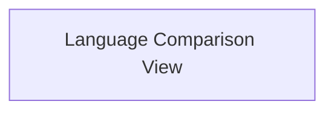
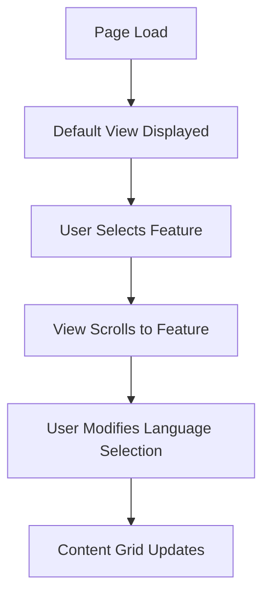

# **Language Comparison SPA UI/UX Specification**

### **Introduction**

This document defines the user experience goals, information architecture, user flows, and visual design specifications for the Language Comparison SPA's user interface. It serves as the foundation for visual design and frontend development, ensuring a cohesive and user-centered experience.

#### **Overall UX Goals & Principles**

- **Target User Personas:**
  - **The Polyglot Aspirant:** An experienced developer who values efficiency and wants to quickly map their existing knowledge to a new language. They are frustrated by beginner-oriented content and need a direct, concept-to-concept comparison tool.
- **Usability Goals:**
  - **Efficiency:** Users should find the information they need in seconds.
  - **Clarity:** The interface must be clean and intuitive, with a clear hierarchy of information.
  - **Control:** Users should feel in control of the data they see via the theme and detail-level toggles.
- **Design Principles:**
  1.  **Content First:** The design must prioritize the readability and accessibility of the comparison table above all else.
  2.  **Speed is a Feature:** Every interaction, from page load to UI toggles, must be instantaneous.
  3.  **Developer Ergonomics:** The design should feel familiar and comfortable to a developer, respecting their workflows and aesthetic preferences (e.g., excellent syntax highlighting, robust theme support).

### **Information Architecture (IA)**

#### **Site Map / Screen Inventory**

As a focused Single-Page Application, the site structure consists of a single primary view.

#### **Navigation Structure**

Traditional multi-page navigation is not applicable. User interaction is handled by in-page controls that manipulate the state of the main view.

- **Primary Controls:** Theme Selector, Detail-Level Toggle.

### **User Flows**

#### **Flow 1: Core Comparison**

- **User Goal:** To compare how a specific programming concept is implemented in two or more languages.
- **Entry Points:** The user arrives directly at the application's main URL.
- **Success Criteria:** The user can easily locate the concept and view the code snippets for their chosen languages side-by-side.

**Flow Diagram:**

**Interaction Steps:**

1.  **Page Load (A):** The application loads for the first time.
2.  **Default View Displayed (B):** The view loads with only 'JavaScript' and 'Python' pre-selected.
3.  **User Selects Feature (C):** The user clicks on a feature in the sticky left sidebar.
4.  **View Scrolls to Feature (D):** The main content area smoothly scrolls to the corresponding section.
5.  **User Modifies Language Selection (E):** The user interacts with the language toggles in the sticky top header.
6.  **Content Grid Updates (F):** The content grid updates instantly to show the selected languages.

**Edge Cases & Error Handling:**

- If the user deselects all languages, a message should appear prompting them to select at least one language.

### **Wireframes & Mockups**

#### **Design Files**

- **Primary Inspiration:** The layout and interaction model will be heavily inspired by `https://component-party.dev`.
- **Initial Wireframe:** The user-provided wireframe establishes the core three-part layout.

#### **Key Screen Layouts**

##### **Main Comparison View**

- **Purpose:** To provide a comprehensive, interactive view for comparing programming language features.
- **Layout Structure:** A three-panel layout:
  1.  **Top Header (Sticky):** Contains the primary application title and the language selector controls.
  2.  **Left Sidebar (Sticky on desktop, hidden on mobile):** Contains the navigation for feature categories.
  3.  **Main Content Area:** The scrollable area that displays the grid of code comparisons.
- **Key Elements:** Application Title, Language Selector, Feature Navigator, Content Cell, Global Controls (Theme Switcher, Detail-Level Toggle).

### **Component Library / Design System**

#### **Design System Approach**

We will use **DaisyUI 5** as our primary component library, leveraging its pre-built, themeable components that work directly with TailwindCSS.

#### **Core Components**

- **Layout Component (`Drawer`):** To manage the responsive layout for the sidebar.
- **Language Toggle Button (`btn` or `badge`):** For the language selector.
- **Sidebar Menu (`menu`):** For the feature navigator.
- **Code Comparison Card (`card`):** For each code snippet in the grid.
- **Theme Controller (`dropdown`):** To switch between themes.
- **Detail-Level Toggle (`tabs` or `join`):** To switch between content detail levels.

### **Branding & Style Guide**

#### **Visual Identity**

The visual identity will be established by DaisyUI's themes, customized to align with the clean, dark, functional aesthetic of the `component-party.dev` site.

#### **Color Palette**

We will leverage DaisyUI's built-in themes: `light` (Light Mode), `dark` (Dark Mode), and `black` (Lights Out Mode).

#### **Typography**

- **Font Families:** A modern, system font stack will be used for performance and a native feel.
- **Type Scale:** We will use TailwindCSS's default proportional type scale.

#### **Iconography**

- **Icon Library:** Lucide for UI icons and `devicon` for language logos.

#### **Spacing & Layout**

- **Grid System:** The layout will be managed using TailwindCSS's Flexbox and Grid utilities.
- **Spacing Scale:** All spacing will adhere strictly to Tailwind's default spacing scale.

### **Accessibility Requirements**

#### **Compliance Target**

- **Standard:** The application **must** meet the **Web Content Accessibility Guidelines (WCAG) 2.1 Level AA** standards.

#### **Key Requirements**

- **Visual:** Color contrast ratios of at least 4.5:1, clear focus indicators, and resizable text.
- **Interaction:** Full keyboard navigability, screen reader support, and adequate touch target sizes.
- **Content:** Logical heading structure and proper use of semantic HTML.

### **Responsiveness Strategy**

#### **1. Screen Breakpoints (for Page Layout)**

These breakpoints control the overall page structure, such as when the sidebar appears. We will use Tailwind's default `min-width` screen breakpoints.

| Breakpoint | Minimum Width | Page Layout Changes                                                                  |
| :--------- | :------------ | :----------------------------------------------------------------------------------- |
| `lg`       | 1024px        | The left sidebar becomes permanently visible. Below this, it is hidden in a drawer.  |
| `2xl`      | 1536px        | The main content area's max-width is increased to better utilize screen real estate. |

#### **2. Container Queries (for Component-Level Adaptation)**

We will use container queries on the individual code comparison cards to allow them to adapt their own layout if they become too compressed.

| Variant   | Minimum Container Width | Example Component Change                              |
| :-------- | :---------------------- | :---------------------------------------------------- |
| `@sm`     | 24rem (384px)           | The card uses a standard layout.                      |
| (Default) | < 24rem (384px)         | The card's header may stack to save horizontal space. |

### **Animation & Micro-interactions**

Animation will be fast, subtle, and meaningful, focusing on hover/active states, theme transitions, the sidebar drawer, and smooth scrolling.

### **Performance Considerations**

The design and architecture (minimalism, system fonts, SSG) will target a First Contentful Paint (FCP) of under 1 second and interaction responses under 100ms.

### **Next Steps**

#### **Immediate Actions**

1.  **Save Artifact:** This document should be saved as `docs/front-end-spec.md`.
2.  **Handoff to Architect:** The project is now ready for the Architect to create the Frontend Architecture document.

#### **Design Handoff Checklist**

- [x] All user flows documented
- [x] Component inventory complete (based on DaisyUI)
- [x] Accessibility requirements defined
- [x] Responsive strategy clear
- [x] Brand guidelines incorporated
- [x] Performance goals established

---
